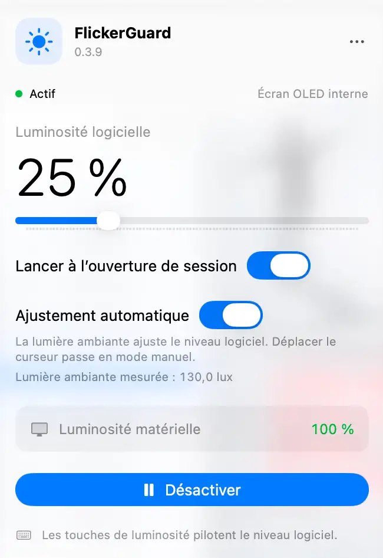

# PWMFixer

> **Fork notice**
>
> PWMFixer is a maintained fork of [FlickerGuard](https://github.com/tcrouzet/FlickerGuard) by Thierry Crouzet, who stopped developing it. The absence of flicker has not been measured with instruments; whether it helps depends on the person.

PWMFixer is for people who experience discomfort from PWM flickering on the new OLED MacBook Pro displays. PWM (pulse-width modulation) controls brightness by rapidly pulsing the display’s light output, which can bother people sensitive to flicker.

PWMFixer keeps hardware brightness at 100% and dims the screen in software to avoid hardware dimming that may introduce PWM flicker. Control brightness from the menu bar with a slider, the keyboard brightness keys, or automatic adjustment to ambient light.

Requires **macOS 27 or later** and a **14-inch or 16-inch MacBook Pro with a PROLED XDR (OLED) display**.



## Install

1. [Download PWMFixer.app.zip](https://github.com/yilmazonline/PWMFixer/releases/latest/download/PWMFixer.app.zip).
2. If an older copy is running, choose **… → Quit PWMFixer** before replacing it.
3. Unzip the download and move **PWMFixer.app** to **Applications**.
4. Open **PWMFixer.app from Applications**. Its sun icon appears in the menu bar.

The app is free and is not notarized by Apple. If macOS blocks it, open **System Settings → Privacy & Security → Open Anyway** after the blocked launch. See [Apple’s instructions](https://support.apple.com/en-us/102445).

From a local checkout, run `./install.sh` to install or update from the latest published GitHub release. It downloads and verifies the app, quits the running copy, runs `tccutil reset Accessibility com.yilmazonline.PWMFixer`, replaces the app in Applications, then launches it. Allow PWMFixer again in **System Settings → Privacy & Security → Accessibility** after installation. It leaves the existing app in place if the download fails, the app cannot quit, or the authorization reset fails. It does not build the app locally. Wait for the GitHub release workflow to finish before installing a newly published version.

## Allow Accessibility access

**This permission is required after downloading and installing the app.** It lets PWMFixer capture the brightness keys. After an update, macOS may require authorization again, even if PWMFixer is already listed as allowed.

1. Click the sun icon, then **Enable** to request permission.
2. Open **System Settings → Privacy & Security → Accessibility** and allow **PWMFixer**. If you add it manually with **+**, select **/Applications/PWMFixer.app**.
3. Quit PWMFixer from its **…** menu, reopen it from **Applications**, then click **Enable** again.

Use the copy in Applications for authorization and normal use.

### Already allowed, but Enable still fails?

macOS can retain an authorization for an older copy of the app. To clear that authorization:

1. Quit PWMFixer from its **…** menu.
2. Open Terminal and run this command manually:

   ```sh
   tccutil reset Accessibility com.yilmazonline.PWMFixer
   ```

3. Reopen PWMFixer from **Applications**, click **Enable**, and allow it again in **System Settings → Privacy & Security → Accessibility**.
4. Quit and reopen PWMFixer once more, then click **Enable**.

The command clears only PWMFixer’s Accessibility authorization. You must grant it again afterward. This is a recovery step for a stale authorization, not part of every normal launch.

## Use

Click the sun icon, then **Enable** after completing the installation and Accessibility steps above. The sun’s center is filled while PWMFixer controls the display and hollow when it is inactive or fully paused.

- **Software brightness:** drag the slider or use the brightness keys. Lower values make the screen darker; 100% removes software dimming.
- **Automatic adjustment:** follows ambient light and ignores small variations. Moving the slider or pressing a brightness key turns it off, keeping your chosen level fixed. Measured ambient light is shown in lux below the switch.
- **Hardware brightness:** shows the screen’s hardware level, held at 100% while PWMFixer is active, except during automatic pause transitions.
- **Disable:** restores your previous macOS brightness and automatic brightness setting.

PWMFixer resumes at the same software level after sleep or closing the lid. It ignores temporary ambient light changes caused by opening and closing the Mac.

## Pause for specific applications

**Use normal display output when accurate color matters.** PWMFixer’s software dimming changes the screen’s light output and can affect how you judge exposure, shadow detail and colors. For photo editing, video editing or color grading, pausing PWMFixer removes this additional dimming and restores your normal macOS display settings.

Open **… → Automatic pauses…** and use **Add applications…** to select Photoshop, Pixelmator, Final Cut Pro, VLC, QuickTime Player, or any other apps. Remove an entry with its minus button. Your list is saved between launches; it starts empty.

When a listed app is in the foreground, PWMFixer gradually restores your previous hardware brightness and removes software dimming over one minute, then releases the brightness keys. Wait for the transition to finish before judging colors. When you switch away, it fades back over one minute to the same software level and automatic/manual mode. Switching apps during a transition reverses it from the current levels. Browser player pauses use the same transitions. Choose **Disable** during a pause or transition to cancel the automatic return. Disable, quit and safety interruptions restore the display immediately.

The separate **Pause in browser player full screen** option targets full-screen content that hides the browser’s tabs and toolbars, such as a video player. Maximizing Chrome or using its normal full-screen window with browser controls visible keeps PWMFixer active. A change must remain stable for two seconds; uncertain readings keep the previous state. The check runs at most once a second for the current browser, in the background, and skips web page contents. It is off by default and uses PWMFixer’s existing Accessibility permission. Detection depends on what the browser exposes to macOS; add the browser to the application list to pause for all its windows instead.

## Start with your Mac

In the **…** menu, turn on **Launch at login**. If macOS requests approval, choose **Allow in macOS Login Items…** and authorize PWMFixer in **System Settings → General → Login Items & Extensions**.

Install and open the app from Applications before enabling this option. PWMFixer opens in the menu bar when you sign in; click **Enable** to activate dimming.

The interface follows your macOS app language and is available in English and French.

## Need help?

If the screen is too bright in automatic mode, move the slider to a comfortable level. This switches to manual mode.

If the app reports no compatible OLED display, your screen is not currently supported. PWMFixer leaves its settings unchanged.

The **…** menu provides **Check for Updates**, **Documentation on GitHub**, and **Report a problem**. When an update is available, choose **Download update**, then replace the app in Applications after quitting PWMFixer.

To report a problem, choose **Copy diagnostic** from the same menu and include it in your issue.

[MIT license](LICENSE).
